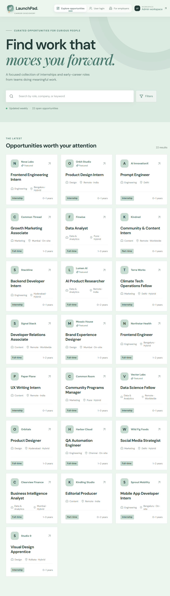
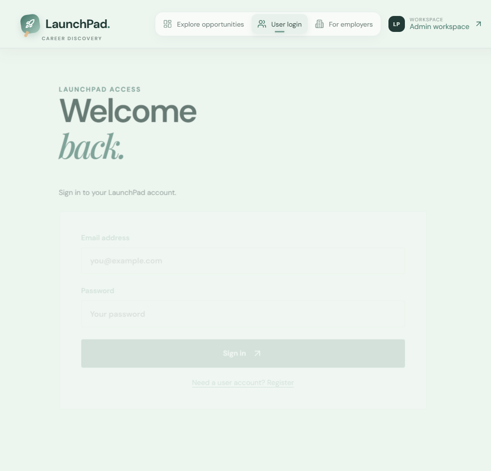
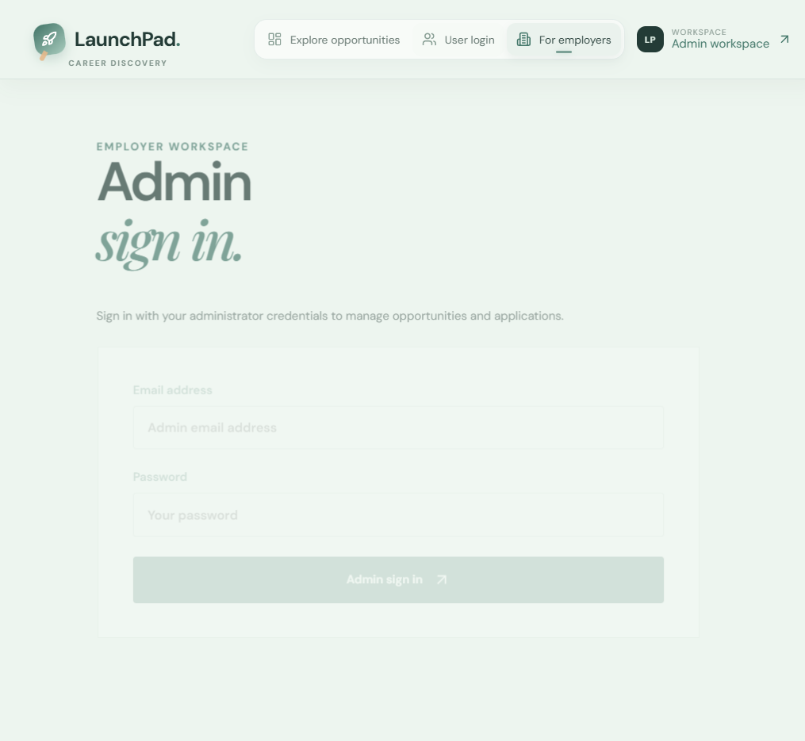

# LaunchPad — Project Presentation

## 1. Project overview

LaunchPad is a focused internship and job opportunity platform. It helps candidates discover roles and submit applications while giving employers a protected workspace for managing listings and reviewing applications.

## 2. Core features

- Opportunity browsing with search and domain filtering
- Opportunity detail pages and external listing links
- User registration and login
- Dedicated administrator login
- Admin CRUD for opportunities
- Application submission with resume upload support
- Application inbox for administrators
- MongoDB persistence and JWT-protected admin APIs

## 3. Technology architecture

```text
React + Vite frontend
          │
          │ REST API / JWT
          ▼
Node.js + Express backend
          │
          ▼
MongoDB Atlas
```

## 4. Deployment

- Source control: GitHub
- Frontend hosting: Render Static Site
- Backend hosting: Render Web Service
- Database hosting: MongoDB Atlas
- Branch deployed: `main`

## 5. UI captures

### Home and opportunity discovery



### User login



### Admin login



## 6. Validation completed

- Production frontend build passes.
- Local registration and login API flows return successful responses.
- Admin authentication is protected by configured credentials and JWT.
- Frontend and backend deploy successfully on Render.
- GitHub repository is synchronized with the latest changes.

## 7. Future improvements

- Add automated integration tests to CI.
- Add pagination and richer search filters.
- Add role-based candidate profiles and saved opportunities.
- Add persistent file storage for uploaded resumes.
