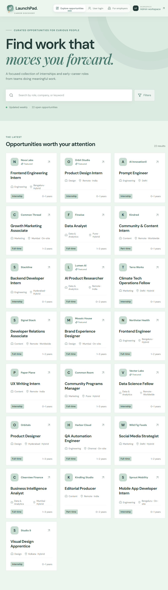
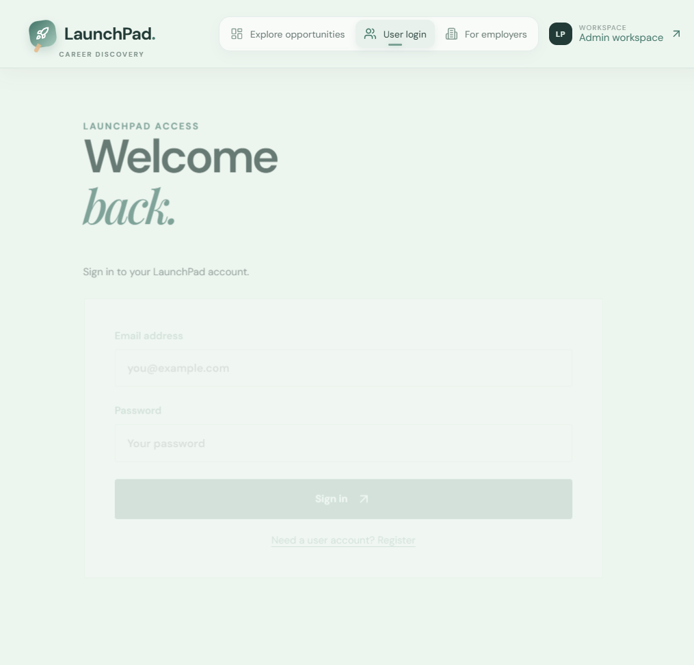
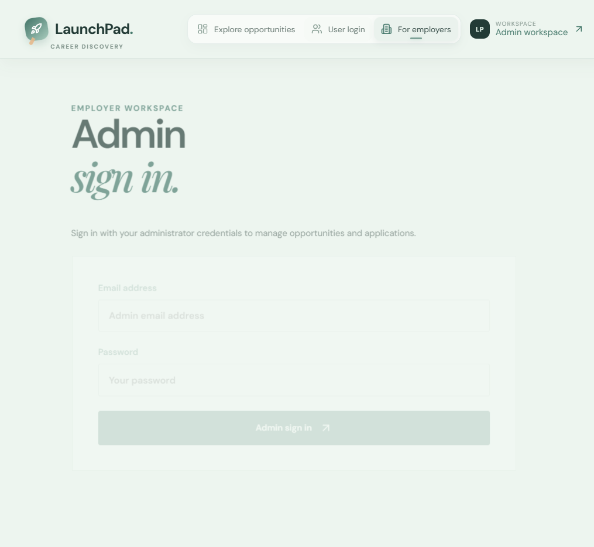

# LaunchPad 🚀

> A focused platform for discovering internships and early-career opportunities — built with the MERN stack.

LaunchPad lets candidates search and apply for curated roles while giving employers a protected workspace to post listings, manage opportunities, and review incoming applications.

---

## Table of Contents

- [Live Demo](#live-demo)
- [Screenshots](#screenshots)
- [Features](#features)
- [Tech Stack](#tech-stack)
- [Project Structure](#project-structure)
- [Getting Started](#getting-started)
- [Environment Variables](#environment-variables)
- [Available Scripts](#available-scripts)
- [API Overview](#api-overview)
- [Deployment (Render)](#deployment-render)
- [Future Improvements](#future-improvements)

---

## Live Demo

| Service | URL |
|---------|-----|
| Frontend | https://launchpad-job-portal-1.onrender.com |
| Backend API | https://launchpad-job-portal.onrender.com/api |

---

## Screenshots

### Home — Opportunity Discovery


### User Login


### Admin Login


---

## Features

### For Candidates
- 🔍 **Search & Filter** — search by role, company, or keyword; filter by domain (Engineering, Design, Marketing, Data & Analytics, Content) and job type (Internship, Full-time, Part-time)
- 🌟 **Spotlight Section** — featured opportunity of the week with an editorial layout
- 📄 **Role Detail Pages** — full editorial profile with company story, learning outcomes, 30-day roadmap, culture values, and perks
- 📝 **Multi-step Application** — guided 3-step form with name, email, resume upload, resume link, and cover note
- 👤 **User Accounts** — register and log in to track your identity across sessions

### For Employers / Admins
- 🏢 **Admin Workspace** — protected employer dashboard (JWT-secured)
- ➕ **Create Opportunities** — add listings with title, company, domain, type, location, experience level, description, and application link
- ✏️ **Edit & Delete** — update or remove listings in real time
- 📥 **Application Inbox** — view all submitted applications with applicant name, email, linked opportunity, status, and submission date

### General
- 📱 **Fully Mobile Responsive** — hamburger navigation drawer, single-column layouts, and touch-friendly controls for all screen sizes
- ⚡ **Fallback Data** — 20 curated demo opportunities load client-side when the API is unavailable
- 🔒 **JWT Authentication** — tokens stored in `localStorage`, Authorization headers sent on all protected requests
- 🎨 **Editorial Design** — Playfair Display + DM Sans typography, animated cards, spotlight section, and smooth page transitions

---

## Tech Stack

| Layer | Technology |
|-------|-----------|
| Frontend | React 18, Vite, Lucide React |
| Styling | Custom CSS (CSS variables, responsive media queries) |
| Backend | Node.js, Express |
| Database | MongoDB, Mongoose |
| Auth | JWT (jsonwebtoken), bcryptjs |
| File Uploads | Multer |
| Email | Nodemailer (optional) |
| Dev tooling | Nodemon, Concurrently |
| Hosting | Render (frontend static site + backend web service) |
| Database hosting | MongoDB Atlas |

---

## Project Structure

```
launchpad-job-portal/
├── client/                   # React + Vite frontend
│   ├── src/
│   │   ├── main.jsx          # All components (single-file SPA)
│   │   └── styles.css        # All styles with responsive breakpoints
│   ├── index.html
│   └── package.json
│
├── server/                   # Node.js + Express backend
│   ├── src/
│   │   ├── index.js          # Express app, routes, and middleware
│   │   ├── seed.js           # Database seeder
│   │   └── data/
│   │       └── initialOpportunities.js
│   ├── models/
│   │   ├── Opportunity.js
│   │   ├── Application.js
│   │   └── User.js
│   ├── .env.example
│   └── package.json
│
├── screenshots/
├── package.json              # Root scripts (install:all, dev, seed)
├── README.md
└── PROJECT_PRESENTATION.md
```

---

## Getting Started

### Prerequisites

- **Node.js** v18 or later
- **MongoDB** running locally, or a [MongoDB Atlas](https://cloud.mongodb.com) connection string

### 1. Clone the repository

```bash
git clone https://github.com/keyurpatil2006-sudo/launchpad-job-portal.git
cd launchpad-job-portal
```

### 2. Configure environment variables

```bash
cp server/.env.example server/.env
```

Then open `server/.env` and fill in your values (see [Environment Variables](#environment-variables) below).

### 3. Install all dependencies

```bash
npm run install:all
```

This installs dependencies for the root, `client`, and `server` packages in one command.

### 4. Seed the database (optional)

```bash
npm run seed
```

Loads a set of initial opportunity listings into MongoDB.

### 5. Start the development servers

```bash
npm run dev
```

| Service | URL |
|---------|-----|
| Frontend | http://localhost:5173 |
| Backend API | http://localhost:5000/api |

---

## Environment Variables

Create `server/.env` based on `server/.env.example`:

```env
PORT=5000
MONGO_URI=mongodb://127.0.0.1:27017/launchpad
JWT_SECRET=replace-with-a-long-random-secret
ADMIN_EMAIL=admin@example.com
ADMIN_PASSWORD=change-me-now

# Optional — email notifications for new applications
SMTP_HOST=smtp.example.com
SMTP_PORT=587
SMTP_SECURE=false
SMTP_USER=
SMTP_PASS=
SMTP_FROM=
NOTIFICATION_EMAIL=
```

> ⚠️ Never commit your `.env` file or real credentials to version control.

For the **frontend**, set this environment variable in Render (or a local `.env` in the `client/` directory):

```env
VITE_API_URL=https://launchpad-job-portal.onrender.com/api
```

---

## Available Scripts

Run all commands from the **project root**:

| Command | Description |
|---------|-------------|
| `npm run install:all` | Install dependencies for root, client, and server |
| `npm run dev` | Start frontend (port 5173) and backend (port 5000) concurrently |
| `npm run seed` | Seed the MongoDB database with initial opportunities |
| `npm run build --prefix client` | Build the frontend for production |

---

## API Overview

All API routes are prefixed with `/api`.

### Auth

| Method | Endpoint | Description |
|--------|----------|-------------|
| `POST` | `/auth/register` | Register a new user |
| `POST` | `/auth/login` | Login (user or admin) — returns JWT |

### Opportunities

| Method | Endpoint | Auth | Description |
|--------|----------|------|-------------|
| `GET` | `/opportunities` | — | List all opportunities |
| `POST` | `/opportunities` | Admin JWT | Create a new opportunity |
| `PUT` | `/opportunities/:id` | Admin JWT | Update an opportunity |
| `DELETE` | `/opportunities/:id` | Admin JWT | Delete an opportunity |

### Applications

| Method | Endpoint | Auth | Description |
|--------|----------|------|-------------|
| `POST` | `/applications` | User JWT | Submit an application (multipart/form-data) |
| `GET` | `/applications` | Admin JWT | List all applications |

---

## Deployment (Render)

The project deploys as two separate Render services from the same GitHub repository.

### Backend — Web Service

| Setting | Value |
|---------|-------|
| Repository | `keyurpatil2006-sudo/launchpad-job-portal` |
| Root directory | `server` |
| Build command | `npm install` |
| Start command | `npm start` |
| Environment variables | `MONGO_URI`, `JWT_SECRET`, `ADMIN_EMAIL`, `ADMIN_PASSWORD` |

### Frontend — Static Site

| Setting | Value |
|---------|-------|
| Repository | `keyurpatil2006-sudo/launchpad-job-portal` |
| Root directory | `client` |
| Build command | `npm install && npm run build` |
| Publish directory | `dist` |
| Environment variables | `VITE_API_URL=https://launchpad-job-portal.onrender.com/api` |

> ✅ Render automatically redeploys both services when new commits are pushed to the `main` branch.

### To push an update

```bash
git add .
git commit -m "your commit message"
git push origin main
```

Render picks up the push and redeploys within ~1–2 minutes.

---

## Future Improvements

- [ ] Pagination and infinite scroll for opportunity listings
- [ ] Richer search filters (city, remote/hybrid/on-site, salary range)
- [ ] Candidate profiles with saved/bookmarked opportunities
- [ ] Persistent file storage for uploaded resumes (e.g., AWS S3 or Cloudinary)
- [ ] Email confirmation on successful application submission
- [ ] Automated integration tests in CI (GitHub Actions)
- [ ] Admin analytics dashboard (applications per listing, conversion rates)

---

## Author

**Keyur Patil** — project built as part of ATG Technologies internship.

- GitHub: [@keyurpatil2006-sudo](https://github.com/keyurpatil2006-sudo)
